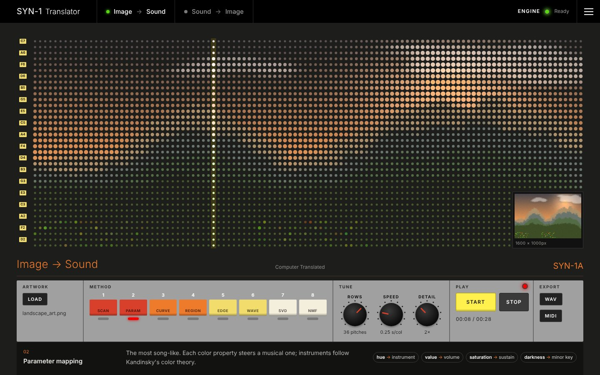
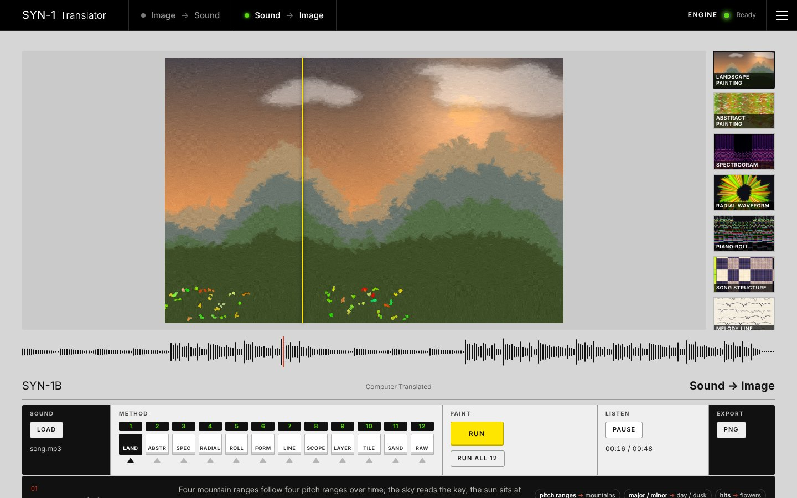

# Ink & Echo: SYN-1 Translator

**Hear a painting. See a song. Watch a song build a face.**
SYN-1 reads artwork as a grid of light and color and plays it as music, then listens to music and paints it back.
There are twenty translation methods, plus a portrait machine where a song builds a person's face particle by particle.
Everything runs in your browser, so your files never leave your device.

**▶ Live site: https://crunchyboba.github.io/ink-and-echo/**




---

## Why

Built for **ART 1901 (Studio Art for Non-Majors), Project 3: *On Value***, a time-based artwork made of, about, or with value.

In painting, *value* means how light or dark a color is. In SYN-1 it is also the material: brightness becomes loudness,
and loudness becomes brightness. The project asks how much of an artwork's value survives being translated for another sense.
Every method keeps something and throws something away, and because translation runs both ways you can close the loop:
painting → sound → painting.

## How it works

| Image → Sound | Sound → Image |
|---|---|
| 1. **Squint.** Shrink the artwork to a grid. Rows are pitches, and the width keeps its proportions. | 1. **Listen.** About 43 times a second, measure loudness, the 12 pitch classes, timbre brightness and onsets. |
| 2. **Read.** Measure every cell as hue, saturation and value. | 2. **Map.** Turn those measurements into shapes, strokes and colors (notes become hues on Scriabin's color keyboard). |
| 3. **Map.** Turn the cells into notes snapped to a scale (instruments follow Kandinsky's color theory). | 3. **Paint.** Render the picture. During playback, a marker follows the song across the image. |
| 4. **Play.** Listen to a WAV preview, or export MIDI to use real instruments in GarageBand or BandLab. | |

### Song → Face

A portrait becomes a halftone grid of particles: darker parts of the photo get bigger particles, like the dot portraits
in old graphic design annuals. Then a song snippet builds it. Low notes fill in the shadows and hair, high notes the highlights,
loud passages build fast, and fresh particles swell on every beat. Choose from 6 particle shapes (circle, ellipse, dash, crescent,
square, diamond) and 4 color modes: **ink** (black and white), **photo** (the person's real colors), **song** (the color of the
notes playing when each particle appeared, on Scriabin's color keyboard) and **blend** (the photo's light and dark, tinted by the song).
*Compare all 24 styles* shows every combination at once.

Backgrounds are removed and faces lined up automatically with Google's MediaPipe, running in the browser. Faces can be saved to a
gallery, recorded as a video with their music, or exported to publish on the site (see [samples/README.md](samples/README.md)).

### Methods

**Image → Sound (8):** scan line · parameter mapping · Hilbert curve · color regions · contour tracing · wavetable · SVD build-up · NMF build-up

**Sound → Image (12):** landscape painting · abstract painting · spectrogram · radial waveform · piano roll · song structure ·
melody line · oscilloscope · layers (NMF) · Hilbert mosaic · cymatics · data bending

The site's *Methods* section has a one-line explanation of each.

## Tech

- **Engine:** Python, using only **NumPy** and **Pillow**. The audio analysis (STFT, mel and semitone filter banks, chroma, MFCCs),
  NMF, k-means, song segmentation, and the WAV and MIDI writers are all written from scratch, so the engine runs in the browser.
- **In the browser:** [Pyodide](https://pyodide.org) runs the Python engine in a Web Worker. Audio files are decoded with the Web Audio API.
- **Front end:** plain HTML, CSS and JavaScript modules, with no build step. It's hosted on GitHub Pages.

## Project structure

```
index.html                  the website
assets/
  css/style.css             all styling
  js/app.js                 interface: intro, the two machines, sections
  js/engine.js              talks to the worker, decodes audio
  js/worker.js              loads Pyodide and the Python engine
  js/methods.js             plain-language description of every method
  js/face/                  Song → Face: align.js (MediaPipe), listen.js (song analysis),
                            particles.js (halftone + build), studio.js (interface),
                            store.js (saved gallery), recorder.js (video export)
  img/                      favicon and social preview
python/
  manifest.json             list of engine files the browser loads
  translator/
    api.py                  the bridge the website calls
    tools.py                shared math (NMF, k-means, Hilbert curve, ...)
    image_to_sound/         grid reading, notes, WAV/MIDI writing, 8 methods
    sound_to_image/         audio analysis, colors, brushes, 12 methods
samples/                    demos and published faces (see samples/README.md)
scripts/build_manifest.py   refreshes python/manifest.json after engine changes
tests/                      tests for every method, including unusual files
cli.py                      run the engine from the terminal
docs/screenshots/           README images
```

## Run it locally

The site is static, so any local web server works:

```bash
python -m http.server 8000
# open http://localhost:8000
```

Or use the engine from the terminal, without a browser:

```bash
pip install -r requirements.txt
python cli.py image painting.jpg               # every Image → Sound method → output/
python cli.py sound song.mp3 -m landscape      # one Sound → Image method
python -m pytest                               # run the tests
```

After changing anything in `python/translator/`, run `python scripts/build_manifest.py` so browsers load the new engine (a test checks this).

## Adding demos

Put files in `samples/artwork/` or `samples/audio/` and list them in `samples/demos.json`.
They then appear in the site's *Demos* section with a one-click "Load" button. See [samples/README.md](samples/README.md).

## Credits and inspiration

- Wassily Kandinsky, *Concerning the Spiritual in Art*: colors as instruments
- Alexander Scriabin's color keyboard: notes as colors
- Peter Meijer's *The vOICe*: hearing images through a scan line
- Ernst Chladni: sand figures on vibrating plates
- Halftone dot portraits from print and computer graphic design
- Visual design inspired by vintage drum-machine hardware and [Roland50.studio](https://roland50.studio)

Made by Aronya Sarker.
